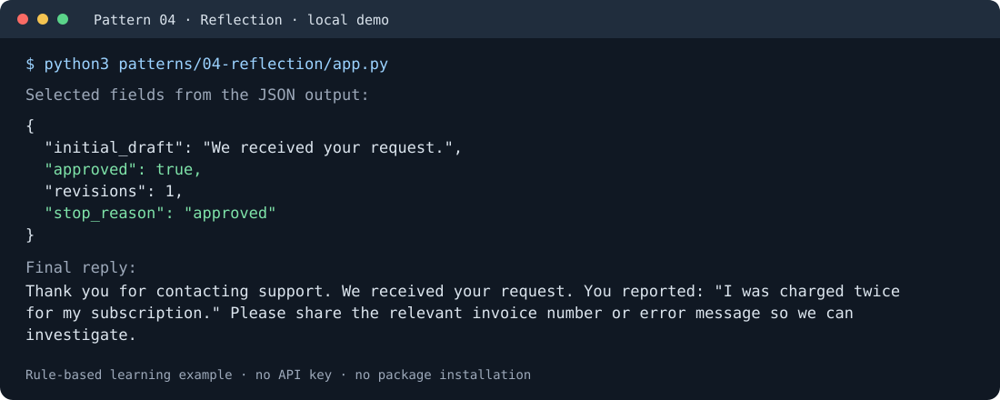

# Agentic Design Patterns Lab

**21 agentic AI design patterns in plain Python, with offline tests and optional OpenAI versions.**

Learn the control flow without an agent orchestration framework. Nineteen local
patterns use only the standard library; MCP and A2A use their official protocol
SDKs. Local examples demonstrate the patterns with rules and fictional data.
Optional OpenAI versions add model calls separately.

## Try a free example

With Git and Python 3.10 or newer:

```bash
git clone https://github.com/aayushga/agentic-design-patterns-lab.git
cd agentic-design-patterns-lab
python3 patterns/04-reflection/app.py
```

This Reflection demo needs no package installation or API key. It drafts a reply,
checks it against a small rubric, revises it, and prints the reviewed result.



The preview shows selected fields from an actual run. The script prints the full
JSON result, including both critiques and the draft history.

Read the [project write-up on Medium](https://medium.com/@aayushgarg86/21-agentic-design-patterns-in-plain-python-with-offline-tests-4b824b7417f4)
for the design choices and lessons from the engineering review.

## Explore all 21 patterns

Each folder contains a pattern explanation, a local implementation, basic and
advanced examples, offline tests, and an optional OpenAI version.

- [x] 01. [Prompt Chaining](patterns/01-prompt-chaining/)
- [x] 02. [Routing](patterns/02-routing/)
- [x] 03. [Parallelization](patterns/03-parallelization/)
- [x] 04. [Reflection](patterns/04-reflection/)
- [x] 05. [Tool Use](patterns/05-tool-use/)
- [x] 06. [Planning](patterns/06-planning/)
- [x] 07. [Multi-Agent Collaboration](patterns/07-multi-agent-collaboration/)
- [x] 08. [Memory Management](patterns/08-memory-management/)
- [x] 09. [Learning and Adaptation](patterns/09-learning-and-adaptation/)
- [x] 10. [Model Context Protocol (MCP)](patterns/10-model-context-protocol/)
- [x] 11. [Goal Setting and Monitoring](patterns/11-goal-setting-and-monitoring/)
- [x] 12. [Exception Handling and Recovery](patterns/12-exception-handling-and-recovery/)
- [x] 13. [Human-in-the-Loop](patterns/13-human-in-the-loop/)
- [x] 14. [Knowledge Retrieval (RAG)](patterns/14-knowledge-retrieval/)
- [x] 15. [Inter-Agent Communication (A2A)](patterns/15-inter-agent-communication/)
- [x] 16. [Resource-Aware Optimization](patterns/16-resource-aware-optimization/)
- [x] 17. [Reasoning Techniques](patterns/17-reasoning-techniques/)
- [x] 18. [Guardrails/Safety Patterns](patterns/18-guardrails-safety/)
- [x] 19. [Evaluation and Monitoring](patterns/19-evaluation-monitoring/)
- [x] 20. [Prioritization](patterns/20-prioritization/)
- [x] 21. [Exploration and Discovery](patterns/21-exploration-discovery/)

The roadmap follows Antonio Gulli's
*[Agentic Design Patterns: A Hands-On Guide to Building Intelligent Systems](https://link.springer.com/book/10.1007/978-3-032-01402-3)*.
These are original, simplified learning exercises inspired by the chapters.

## Run tests and protocol examples

See the [local setup and testing guide](docs/running-local.md) for the full lab,
standalone suites, and free MCP/A2A examples. Python 3.11 or newer is required for
the complete lab; the supported subset also runs on Python 3.10.

The full installation includes protocol dependencies. Intel Mac users should read
the [platform limitation](docs/dependencies.md#intel-macos-limitation) first.
The quick-start Reflection demo above does not require those dependencies.

Tests use fake model responses and block socket connections during collection and
execution. They require no API key and make no live model requests. Separate HTTP
contract tests exercise the real OpenAI SDK against a mock HTTP transport.

## Optional OpenAI versions

All 21 patterns also have an optional version using the official OpenAI Python SDK
and Responses API. These versions incur API charges when deliberately run.

Read the [OpenAI setup, model requirements, and request limits](docs/openai-versions.md),
then follow the linked setup guide for your chosen pattern. Local-only users do
not need the OpenAI SDK. Offline tests verify request construction and application
behavior; they do not establish live model quality or account access.

To use GPT-6.1 Sol, set `OPENAI_MODEL=gpt-6.1-sol`. The
[model-switching guide](docs/openai-versions.md#switch-models) covers terminal and
Python overrides, switching back to Astra, and the separate economy-model setting.

## Continuous checks

[Python tests](https://github.com/aayushga/agentic-design-patterns-lab/actions/workflows/tests.yml)
cover Python 3.10, 3.11, 3.12, and 3.14 with each version's supported pattern subset,
plus minimum/latest-compatible OpenAI SDK HTTP contracts.
[Repository quality](https://github.com/aayushga/agentic-design-patterns-lab/actions/workflows/quality.yml)
checks static analysis, application coverage, installation consistency, and known
dependency vulnerabilities.

CI uses GitHub-hosted Linux runners. Dependency downloads and advisory lookups use
the network; model tests and local demos make no paid API calls.

## Scope and engineering notes

This repository is a learning and portfolio lab. Production deployments need
application-specific authentication, durable state, safe writes, and representative
evaluations. See:

- [Security boundaries](SECURITY.md)
- [Engineering review and deployment recommendations](docs/engineering-review.md)
- [Dependency and platform policy](docs/dependencies.md)

The code is available under the [MIT license](LICENSE).
